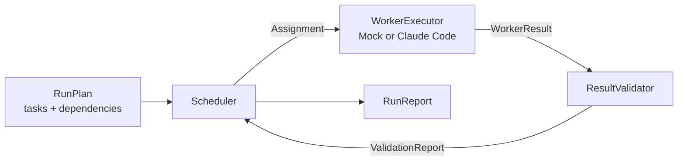

# AgentForge

A local-first Windows platform where one lead agent coordinates specialized coding agents. It ships
with five, and you can add, remove or fully customize any of them.

**Status:** M1–M3 and the first two parts of M4 (task retries and pause/resume) are implemented as
a Python library. The desktop app, REST API, persistence and the lead agent are planned, not built.

## What is AgentForge

AgentForge is a planned Windows desktop platform for coordinating software development agents. A
lead agent breaks a request into tasks, and specialized workers carry them out under deterministic
control and human approval. Five agents come by default (backend, frontend, database, QA and
integration). The team is yours to shape: add or remove agents, and set each one's role, model,
reasoning level and persona. At most five run at once.

What exists today is the core library (`apps/api/src/agentforge`):

- **Contracts:** immutable task, worker, result and report models.
- **Scheduler:** a deterministic, in-memory async scheduler that runs a task graph on up to five
  workers at once.
- **Workers:** five mock workers for demos and tests, plus a worker that runs the Claude Code
  CLI. It is read-only unless a task allows edits, and it never runs commands.
- **Worktrees:** each task can get its own Git worktree, and its diff is recorded.
- **Validation:** a validator that runs your check commands, such as pytest, on the result.

The mock demo and the offline tests need no account or API key. Real Claude Code workers use your
logged-in Claude Code install.

## Why AgentForge

- **The model doesn't control the run.** AI reasoning is kept apart from scheduling, execution
  control, validation, permissions and human approval. Plain, testable code decides what runs
  next and when a task is done.
- **Agent output isn't trusted.** Every result goes through an independent validator before a
  task counts as completed. `CommandValidator` runs your check commands itself and ignores
  what the worker says it checked.
- **Local-first.** The scheduler, workers and state run on your machine, with no server to
  host. The Claude Code worker does send the files it reads to Claude, like any Claude Code
  session.
- **Replaceable workers.** Every worker sits behind one small interface, so a mock, Claude Code
  or a future runtime can be swapped without touching the scheduler.

## Core design



- **Immutable contracts.** Every model is a frozen Pydantic object that rejects unknown fields.
  The scheduler records progress by replacing values, never by changing them in place.
- **The whole graph is checked first.** Before anything runs, `run()` checks for unique IDs,
  known dependencies, registered roles and cycles. A bad plan raises an error; a failed task is
  reported in the `RunReport` instead.
- **Deterministic dispatch.** Ready tasks run by priority, then by ID, on the matching role's
  free worker. `max_concurrency` is 1–5 (default 5).
- **Failure stays local.** A failed or cancelled task blocks only the tasks that depend on it.
  Independent branches keep running.
- **Retries start clean.** A task can allow up to five attempts. Each retry gets a fresh worktree
  and session and is told why the last attempt failed.
- **Pause and resume.** Pausing a task or the run stops its workers at once. Resuming continues
  the same attempt in the same worktree and Claude session.
- **Clean cancellation.** Cancelling a task or a run stops its work and waits for cleanup. For
  Claude Code this kills the CLI process.
- **Restricted Claude Code worker.** Each task gets one `claude -p` process limited to the Read,
  Glob and Grep tools, with a spending cap, a fresh session ID and a schema-checked result. A
  task that allows `"edit"` adds Edit and Write. No worker can run commands.
- **One worktree per task.** Edits happen in a separate Git worktree, never in your checkout.
  AgentForge records the diff with Git instead of asking the worker what it changed.
- **Editable personas.** Each agent is one Markdown file: its settings plus a persona that the
  Claude Code worker adds to its system prompt. Setup gives you the five defaults, and you can
  edit, add or remove agents.

State is lost when the process exits. What is built and what is planned (persistence,
the lead agent, the API and the desktop app) is in [ROADMAP.md](ROADMAP.md).

## Prerequisites

- Windows with PowerShell
- Python 3.11 or newer
- Git, to clone the repository
- For real (non-mock) workers only: Claude Code installed and logged in. The VS Code extension
  bundles `claude.exe`. An npm install's `claude.cmd` launcher is rejected; pass the path to
  `claude.exe`.

## Install

From the repository root in PowerShell:

```powershell
python -m venv .venv
.\.venv\Scripts\python.exe -m pip install -e "./apps/api[dev]"
```

Installation requires package access. Virtual-environment activation is optional when using the
explicit interpreter paths above. Build/runtime/dev dependency ranges are in `apps/api/pyproject.toml`.

## Quick start

### 1. Run the mock demo

```powershell
.\.venv\Scripts\python.exe -m agentforge
```

The example waits until all five mock workers are executing, releases them together, validates their
mock evidence, and prints the execution report as JSON. It does not execute commands or modify a
repository.

### 2. Set up the agents

```powershell
.\.venv\Scripts\python.exe -m agentforge setup
```

This creates `%APPDATA%\AgentForge\agents` with the five default personas and prints the path.
Running it again never overwrites your edits. See [Agents and personas](#agents-and-personas).

### 3. Run Claude Code workers

`ClaudeCodeExecutor` runs one `claude -p` process per task in the task's workspace folder. Workers
are **read-only**: they can read, search and list files, but not edit files or run commands. Each
task gets a fresh session ID and a spending cap (`max_budget_usd`, default $1). Claude Code ships
with the VS Code extension but is not on PATH, so pass the full path. This example registers every
agent from your persona folder:

```python
import asyncio
from pathlib import Path

from agentforge.claude_code import ClaudeCodeExecutor
from agentforge.domain import RunPlan, TaskSpec
from agentforge.mocks import MockValidator
from agentforge.orchestration import Scheduler
from agentforge.personas import default_folder, load_agents

CLAUDE = Path.home() / (
    r".vscode\extensions\anthropic.claude-code-2.1.323-win32-x64\resources\native-binary\claude.exe"
)

async def main():
    scheduler = Scheduler(validator=MockValidator())
    claude = ClaudeCodeExecutor(command=(str(CLAUDE),), on_event=lambda task_id, e: print(task_id, e["type"]))
    for agent in load_agents(default_folder()):  # each agent's persona becomes its system prompt
        scheduler.register_worker(agent, claude)
    task = TaskSpec(id="t1", run_id="r1", title="Summarize the README", role="qa",
                    workspace_reference=r"C:\path\to\some\project")
    print((await scheduler.run(RunPlan(id="r1", tasks=(task,)))).model_dump_json(indent=2))

asyncio.run(main())
```

Each run is billed to your Claude Code login. Add `timeout_seconds=600` to a task to stop a worker
that runs longer than ten minutes; the attempt then fails as `worker_timeout`.

To try one task without writing Python, use the `claude` command. It loads your agents, runs one
read-only task in the folder you name and prints the report:

```powershell
$env:AGENTFORGE_CLAUDE = "$env:USERPROFILE\.vscode\extensions\anthropic.claude-code-2.1.323-win32-x64\resources\native-binary\claude.exe"
.\.venv\Scripts\python.exe -m agentforge claude "Summarize the README" --workspace C:\path\to\project --timeout 600
```

`--role` picks the agent (default `qa`). Details are in [the M2 doc](docs/milestones/M2-claude-code.md).

### 4. Let a worker edit code in a worktree

Wrap the executor in `WorktreeExecutor`, allow `"edit"` on the task, and use `CommandValidator`
to run real checks. Change these lines in the example above:

```python
from agentforge.validation import CommandValidator
from agentforge.worktrees import WorktreeExecutor

    scheduler = Scheduler(validator=CommandValidator(checks={"unit": ("python", "-m", "pytest")}))
    worker = WorktreeExecutor(claude, root=r"C:\path\to\worktrees")  # share one for all agents
    ...
        scheduler.register_worker(agent, worker)
    task = TaskSpec(id="t1", run_id="r1", title="Fix the failing test", role="backend",
                    repository_reference=r"C:\path\to\some\repo",  # base_commit defaults to HEAD
                    allowed_operations=("edit",), execution_constraints=("check:unit",))
```

The worker edits `C:\path\to\worktrees\r1\t1\1` (run, task, attempt), not your checkout. Afterwards
`report.attempts[0].result.diff` holds the change, and the task completes only if pytest exits 0
there. The worktree is kept. When the run is finished and reviewed, delete all of its worktrees:

```powershell
.\.venv\Scripts\python.exe -m agentforge clean r1 --repo C:\path\to\some\repo --root C:\path\to\worktrees
```

In Python that is `await agentforge.worktrees.remove_run(repo, root, "r1")`. Uncommitted changes in
those worktrees are deleted with them; the diff stays in the report.

Two things to know first. Checks run code the worker wrote, with your user rights: a worktree
is not a sandbox. And edit mode was confirmed against the live CLI in one check, with one model:
edits worked, and writes outside the worktree or to its `.git` file were refused. Both are
detailed in [the M3 doc](docs/milestones/M3-worktrees.md).

### 5. Retry a failed task

Add `max_attempts` (1–5, default 1) to the task:

```python
    task = TaskSpec(..., execution_constraints=("check:unit",), max_attempts=3)
```

If pytest fails, the task runs again in a new worktree (`...\r1\t1\2`) with a new Claude session,
and the worker is told the check output. The task fails only when all three attempts have failed.
Every attempt is billed. `report.attempts` lists each one with its diff and failure message, and
`report.transitions` gives a reason for every status change: why a task was retried, failed,
blocked or cancelled.

To follow a run as it happens, turn on logging before you start it:

```python
import logging

logging.basicConfig(level=logging.DEBUG)
```

Logs never contain prompts, diffs or check output. What each line means, and where to look when a
run goes wrong, is in [the M4 doc](docs/milestones/M4-orchestration.md#how-to-debug-a-run).

### 6. Pause and resume

While `scheduler.run(plan)` is running as an asyncio task, call these from the same event loop:

```python
    await scheduler.pause_task("t1")   # or: await scheduler.pause_run()
    ...
    await scheduler.resume_task("t1")  # or: await scheduler.resume_run()
```

A task that has not started is held. A running task's Claude process is killed and its worker is
freed; resume continues the same attempt in the same worktree with `claude --resume`, so it does
not use up a retry. `run()` does not return while anything is paused, and `resume_run` leaves a
task you paused with `pause_task` paused. Limits, such as a file left half-written by the kill,
are in [the M4 doc](docs/milestones/M4-orchestration.md#limits).

### 7. Verify

```powershell
.\.venv\Scripts\python.exe -m pytest apps/api/tests
.\.venv\Scripts\python.exe -m ruff check apps/api
.\.venv\Scripts\python.exe -m ruff format --check apps/api
```

## Agents and personas

Each agent is one Markdown file named after its id, such as `backend.md`. Settings go between the
two `---` lines, and the persona text follows:

```markdown
---
id: backend
role: backend
model:
reasoning: medium
---
You are the backend engineer on an AgentForge team. ...
```

| Setting | Meaning |
|---|---|
| `id` | Unique name, which is also the file name. Lowercase letters, digits, `-` and `_` only. |
| `role` | Which tasks the agent takes. Several agents may share a role. |
| `model` | Claude model to use, such as `opus` or `claude-opus-5-5`. Leave it empty for Claude Code's default. Spaces are not allowed. |
| `reasoning` | Effort level: `low`, `medium`, `high`, `xhigh` or `max`. |

The persona text (up to 10,000 characters) is added to the Claude Code worker's system prompt.

- **Defaults:** backend, frontend, database, qa and integration. They ship in
  [apps/api/src/agentforge/default_personas](apps/api/src/agentforge/default_personas) and are
  copied to `%APPDATA%\AgentForge\agents` by `python -m agentforge setup`, but only when that
  folder has no agents yet.
- **Edit** a file in any text editor, or call `save_agent(folder, agent)`.
- **Add** a new `<id>.md` file, or call `save_agent` with a new id.
- **Remove** the file, or call `remove_agent(folder, agent_id)`.
- **Load** them all with `load_agents(folder)`. A broken file raises an error that names it.

These functions are in `agentforge.personas`. Editing agents on screen is planned for the desktop
app (M6), which will call these same functions.

## Documentation

- [CONTRIBUTING.md](CONTRIBUTING.md): setup, commands, workflow, commit rules and a map of the
  code.
- [ROADMAP.md](ROADMAP.md): milestones, deferred work and verification history.
- [GOVERNANCE.md](GOVERNANCE.md): who decides, and what AI agents may do in this repository.
- [CLAUDE.md](CLAUDE.md): rules for AI coding assistants.
- [M1: domain and scheduler](docs/milestones/M1-domain.md): contracts, scheduling policy, limits
  and acceptance checks.
- [M2: Claude Code adapter](docs/milestones/M2-claude-code.md): executor contract, CLI flags,
  outcome mapping, the live check, the timeout and the `claude` command.
- [M3: worktrees and validation](docs/milestones/M3-worktrees.md): worktrees, edit mode, diffs,
  check commands, risks and deferred work.
- [M4: retries and pause/resume](docs/milestones/M4-orchestration.md): retry rules, pause and
  resume, how to debug a run, limits and the M4 parts still planned.
